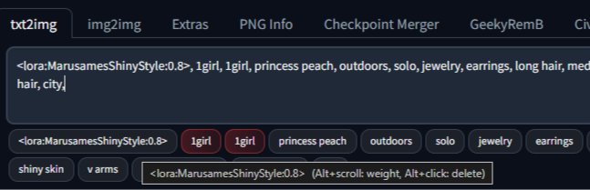

# Taggerator



A small drag-and-drop **tag separator** for the prompt boxes of Stable Diffusion WebUI Forge Classic.

When you type comma-separated words into a prompt box, Taggerator renders them as a list of draggable tag chips underneath the box. Drag a chip left or right and the matching text moves to its new place in the prompt, in real time.

Inspired by the tag-reordering feature of [sd-webui-prompt-all-in-one](https://github.com/Physton/sd-webui-prompt-all-in-one) — without the rest of that project, and without any Python code of its own, so it should survive Forge updates.

## Features

- Comma-separated prompt words appear as chips under the prompt box
- Drag a chip to reorder the text in the prompt — the textarea is updated immediately
- **Alt + Scroll** over a chip raises or lowers that tag's weight — bare tags get wrapped as `(tag:0.9)`, weighted tags adjust the number, and network tags adjust their strength
- LoRA / LyCORIS / hypernet tags like `<lora:name:0.8>` are kept intact as a single chip, and their weight adjusts in fine steps (0.05)
- When a LoRA loads without a comma — `<lora:1> triggerword` — the tag and its trigger word become two separate chips (the `>` acts like the comma the picker forgot), and editing inserts the comma for you
- Weights above 1 work (`:2`), and a tag whose weight lands exactly on 1.0 sheds its parens, matching the WebUI's own attention editor
- Works on all prompt boxes: txt2img, img2img, negative prompts, and the hires fix prompt fields
- **Shift + Click** on a chip moves it one position to the left (keyboard-friendly alternative)
- **Alt + Click** on a chip removes that tag from the prompt — the Alt makes it deliberate, so a stray click never deletes anything
- Repeated tags get a **subtle red tint** so accidental doubles stand out — but duplicates separated by BREAK (usually intentional) get a much fainter one. `(solo:1.2)` and `solo` count as the same tag
- Bracket-aware splitting: `(a, b)`, `[a|b]`, `{a, b}`, `<lora:name:0.8>` are each kept intact as a single tag
- `BREAK` is always its own chip, even without commas — `a BREAK b` and `a BREAK b` typed on separate lines split into `a`, `BREAK`, `b` (lookalikes like `BREAKFAST` are left alone)
- Trailing commas are ignored — `1girl, land,` shows two chips, and the comma is kept if you reorder (it's a habit worth preserving)
- Keeps prompts tidy: after a reorder, tags are trimmed and rejoined with a single space, so the prompt always reads `tag1, tag2, tag3`
- Pure frontend — no Python, no settings, nothing to break

## Install

From the **Extensions** tab of the WebUI:

1. Click **Install from URL**
2. Paste `https://github.com/Marusame00/Taggerator.git`
3. Click **Install**, then **Apply and restart UI**

Or manually, from a shell:

```sh
git clone https://github.com/Marusame00/Taggerator.git extensions/Taggerator
```

Then restart the WebUI.

## Usage

Type a prompt like this into any prompt box:

```
masterpiece, best quality, 1girl, (solo:1.2), forest
```

Four chips appear underneath: `masterpiece`, `best quality`, `1girl`, `(solo:1.2)`, `forest`. Drag `forest` to the front and the prompt becomes:

```
forest, masterpiece, best quality, 1girl, (solo:1.2)
```

The chip list refreshes as you type (with a short debounce) and hides itself when there is nothing to reorder.

## Adjusting weights

With **Alt held**, scroll the mouse wheel over a chip:

| Tag state | Scroll up | Scroll down |
| --- | --- | --- |
| `masterpiece` (bare) | `(masterpiece:1.1)` | `(masterpiece:0.9)` |
| `(solo:1.2)` | `(solo:1.3)` | `(solo:1.1)` |
| `<lora:style:0.8>` | `<lora:style:0.85>` | `<lora:style:0.75>` |
| `[cat:dog:0.4]` (schedule) | untouched — schedules are not weights | untouched |

The step sizes follow the WebUI's own Settings (`keyedit_precision_attention` for parens, `keyedit_precision_extra` for network tags), so Taggerator behaves exactly like the built-in Ctrl+Up/Ctrl+Down attention editor. If the weight reaches exactly `1.0`, the parentheses are removed, just like the built-in editor does.

## Deleting tags

**Alt + Click** on a chip removes that tag from the prompt. A plain click, and even a double-click, do nothing — deletion only happens with the modifier held, so you can click around the chip row freely without risking your prompt.

## Compatibility

- Built and tested against [sd-webui-forge-classic](https://github.com/Haoming02/sd-webui-forge-classic) (the `neo` branch / Forge Classic build)
- Likely works on other Forge and A1111-derived builds too, since it only uses DOM ids and Forge's `updateInput`/`onUiLoaded` globals (with plain-event fallbacks if those are missing)
- No `install.py`, no `requirements.txt`, no Python entry point — the JavaScript and stylesheet are loaded automatically by the WebUI's extension loader

## Roadmap

- Pointer/touch drag support
- Toggle Taggerator per prompt box

## Made with AI

Taggerator was built with the help of the Abacus desktop client and the Smaug Flash (thinking) model: the user conceived the feature set and verified each release in their local WebUI, while the AI assisted with the implementation, edge-case handling and documentation.

## License

[MIT](LICENSE)
